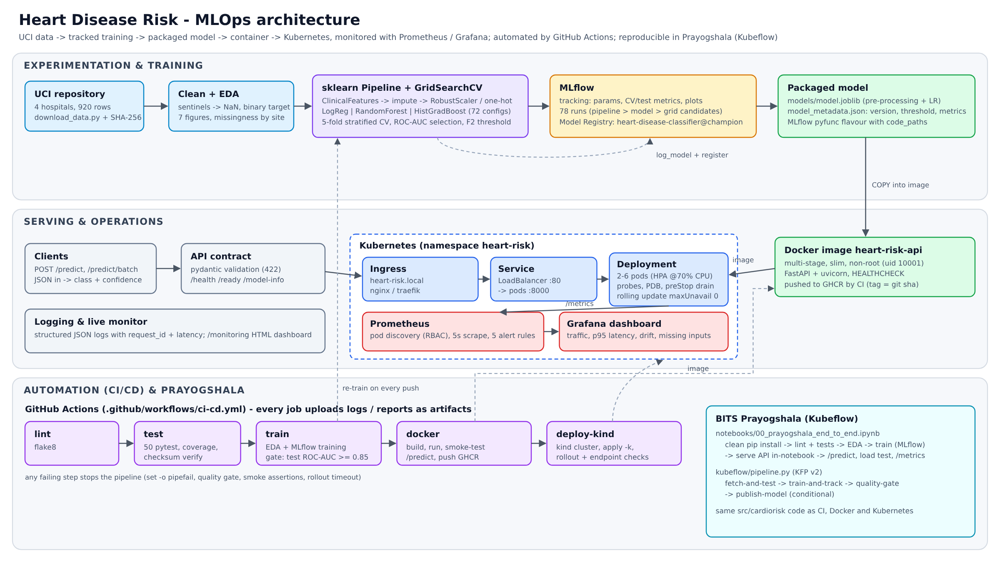

# Heart Disease Risk: End-to-End MLOps

**MLOps (AIMLCZG523), Assignment 1**: Shankaraguru Ramdurg (2025AE05523), BITS Pilani WILP M.Tech AI & ML

A heart-disease risk classifier trained on the UCI Heart Disease data and served as a monitored REST API.
The project covers reproducible training with MLflow tracking and a model registry, automated testing,
a GitHub Actions CI/CD pipeline, a Docker image, Kubernetes manifests, and Prometheus/Grafana monitoring.
It also runs end to end in **BITS Prayogshala** (Kubeflow).



| | |
|---|---|
| Data | all 4 UCI hospitals (Cleveland, Hungary, Switzerland, VA), 918 rows after cleaning |
| Champion model | L1 logistic regression inside a single sklearn `Pipeline` (feature engineering + imputation + scaling + one-hot) |
| CV ROC-AUC (5-fold) | **0.905 ± 0.014** (random forest 0.895, gradient boosting 0.891) |
| Hold-out test | ROC-AUC 0.900, recall 0.912, specificity 0.732, accuracy 0.832 at the tuned threshold 0.39 |
| Tracking | MLflow: 78 runs (pipeline > model family > every grid candidate), registry alias `champion` |
| Tests | 50 pytest tests, 97% line coverage; flake8 clean |
| Serving | FastAPI `/predict` returns prediction, probability, confidence, risk band and which inputs were imputed |
| Deployment | Kubernetes Deployment (2-6 pods, HPA), LoadBalancer Service, Ingress, PDB; zero-downtime rollouts verified |
| Monitoring | Prometheus metrics + 5 alert rules, Grafana dashboard, JSON request logs, built-in `/monitoring` page |

---

## Repository layout

```
├── data/raw/                 UCI files + CHECKSUMS.sha256        data/processed/heart_clean.csv
├── scripts/                  download_data.py, load_test.py
├── src/cardiorisk/           config, data, eda, features, evaluate, train
│   └── serving/              FastAPI app, schemas, model store, Prometheus metrics, dashboard.html
├── notebooks/                00_prayogshala_end_to_end, 01_eda, 02_training, 03_inference
├── tests/                    data, model, API, configs, pipeline smoke tests
├── params.yaml               every training setting (grids, CV, threshold policy)
├── models/                   model.joblib + model_metadata.json (packaged champion)
├── reports/                  figures/, metrics.json, eda_summary.json
├── Dockerfile, .dockerignore, docker-compose.yml
├── k8s/base/                 namespace, configmap, deployment, service, ingress, hpa, pdb (kustomize)
├── k8s/overlays/k3s/         Traefik ingress variant
├── k8s/monitoring/           in-cluster Prometheus (RBAC pod discovery) + Grafana
├── monitoring/               prometheus.yml, alert_rules.yml, Grafana provisioning + dashboard
├── kubeflow/pipeline.py      KFP v2 pipeline for Prayogshala
├── .github/workflows/ci-cd.yml
├── screenshots/              evidence for the report
└── report/                   final report (docx) + video script
```

## 1. Setup

Requires Python 3.10-3.13 (CI and Docker use 3.11).

```bash
python -m venv .venv && source .venv/bin/activate     # Windows: .venv\Scripts\activate
pip install -r requirements.txt && pip install -e .     # or: make install
```

## 2. Data

```bash
python scripts/download_data.py            # downloads the UCI zip, writes checksums, builds the clean CSV
python scripts/download_data.py --zip heart+disease.zip   # offline: use a manually downloaded zip
```

The four raw `processed.*.data` files are committed, so `--skip-if-present` works without internet.
Cleaning (`src/cardiorisk/data.py`) maps `?` and impossible zeros (`chol = 0`, `trestbps = 0`) to NaN,
drops duplicates, binarises the target (`num > 0`), and keeps every row: imputation happens inside the model pipeline.

## 3. EDA, training and experiment tracking

```bash
python -m cardiorisk.eda        # 7 figures -> reports/figures
python -m cardiorisk.train      # GridSearchCV for 3 model families, all logged to MLflow
mlflow ui --backend-store-uri sqlite:///mlflow.db       # http://localhost:5000
```

Main modelling decisions (details in `notebooks/02_training.ipynb` and the report):

* **Stratified split on site × target**, because the positive rate ranges from 36% to 93% across hospitals.
* **Engineered features**: `hr_reserve_pct = thalach / (220 − age)` and `age_x_oldpeak`.
* **RobustScaler** for long-tailed `chol`/`trestbps`. **One-hot** encoding with "missing" as a level for `ca`/`thal`/`slope`.
* **No missing-value indicators**: missingness mostly identifies the hospital. An ablation run logged in MLflow confirms they add nothing (OOF ROC-AUC 0.9045 vs 0.9044).
* **Model selection uses CV ROC-AUC only**; the test set is used once.
* **Decision threshold** maximises F2 on out-of-fold predictions while keeping specificity ≥ 0.70, which gives 0.39.

## 4. Tests and lint

```bash
flake8 src tests scripts kubeflow
pytest -v --cov=cardiorisk
```

## 5. Serve the model

```bash
uvicorn cardiorisk.serving.app:app --port 8000
curl -X POST localhost:8000/predict -H 'content-type: application/json' -d @samples/high_risk.json
```

```json
{"prediction":1,"label":"heart disease risk","probability":0.9808,"confidence":0.9808,"risk_band":"high",
 "threshold":0.39,"missing_features":[],"request_id":"84e1e814443b","model_version":"1.0.0+327a95bf"}
```

Endpoints: `/predict`, `/predict/batch`, `/health`, `/ready`, `/model-info`, `/metrics`, `/monitoring`, `/docs`.
Only `age`, `sex` and `cp` are mandatory. Missing optional inputs are imputed and listed in `missing_features`.
Invalid input returns **422** with per-field errors.

## 6. Docker

```bash
make train                                    # models/ must exist before building
docker build -t heart-risk-api:latest .
docker run -d -p 8000:8000 --name heart-api heart-risk-api:latest
make smoke                                    # health + 3 sample predictions + invalid payload
```

The image is multi-stage, includes only the serving dependencies (`requirements-serve.txt`), runs as non-root uid 10001,
and has a `HEALTHCHECK`.

**Full local stack** (API + Prometheus + Grafana + MLflow):

```bash
docker compose --profile tracking up -d --build
python scripts/load_test.py --requests 500 --delay 0.05
# Grafana http://localhost:3000 (dashboard "Heart Disease Risk API"), Prometheus :9090, MLflow :5000
```

## 7. Kubernetes deployment

```bash
# minikube:  minikube start && eval $(minikube docker-env) && docker build -t heart-risk-api:latest .
# kind:      kind create cluster && kind load docker-image heart-risk-api:latest
kubectl apply -k k8s/base                 # k3s / Rancher Desktop: kubectl apply -k k8s/overlays/k3s
kubectl -n heart-risk rollout status deploy/heart-risk-api
kubectl -n heart-risk get all,ingress,hpa,pdb
kubectl apply -k k8s/monitoring           # Prometheus (NodePort 30090) + Grafana (NodePort 30300)
```

Access:

* **LoadBalancer**: external IP on GKE/EKS/AKS, `localhost` on Docker Desktop, `minikube tunnel` on minikube.
* **Ingress**: add `<ingress-ip> heart-risk.local` to `/etc/hosts`, then `curl http://heart-risk.local/predict ...`
* **Port-forward**: `kubectl -n heart-risk port-forward svc/heart-risk-api 8080:80`

For a cloud cluster, use the image CI pushes to `ghcr.io/<github-user>/heart-risk-api:<sha>`.

## 8. CI/CD (GitHub Actions)

`.github/workflows/ci-cd.yml` runs on every push and PR:

`lint` → `test` (JUnit + coverage) → `train` (MLflow, **quality gate: test ROC-AUC ≥ 0.85**) →
`docker` (build, run, smoke-test `/predict`, push to GHCR on `main`) → `deploy-kind` (kind cluster, apply manifests, wait for rollout, test the Service with 100 requests).
Every job uploads its logs and reports as artifacts and writes a summary on the run page. Any failure stops the pipeline.

## 9. Prayogshala (Kubeflow)

1. Zip the repo (or push it to GitHub) and upload `heart-disease-mlops.zip` to the Prayogshala notebook server.
2. Open `notebooks/00_prayogshala_end_to_end.ipynb` → **Run All** (CPU is enough, about 3 minutes).
   It does a clean install, runs lint and tests, EDA and training with MLflow, then serves the API inside the notebook and calls it.
3. Optional: set `RUN_KFP_PIPELINE = True` to submit `kubeflow/pipeline.py`
   (`fetch-and-test → train-and-track → quality-gate → publish-model`).

## 10. Monitoring

* **Metrics** (`/metrics`): request count, latency histogram, in-flight requests, predictions by outcome and risk band,
  predicted-probability histogram, imputed inputs per feature, validation errors, model info.
* **Alerts** (`monitoring/alert_rules.yml`): API down, 5xx rate > 5%, p95 latency > 250 ms,
  prediction drift (positive rate > 25 points from the training base rate), imputation-heavy traffic.
* **Logs**: one JSON line per request with `request_id` (also returned as the `x-request-id` header), latency and status.
  Prediction events are logged separately.

## Reproducibility

Pinned `requirements.txt`, fixed seeds, SHA-256 checksums for the raw data, the data hash logged to MLflow, and a model version that includes the data hash.
Preprocessing is saved inside the model artefact. Re-running training from a clean environment reproduces identical metrics and the same model version.
